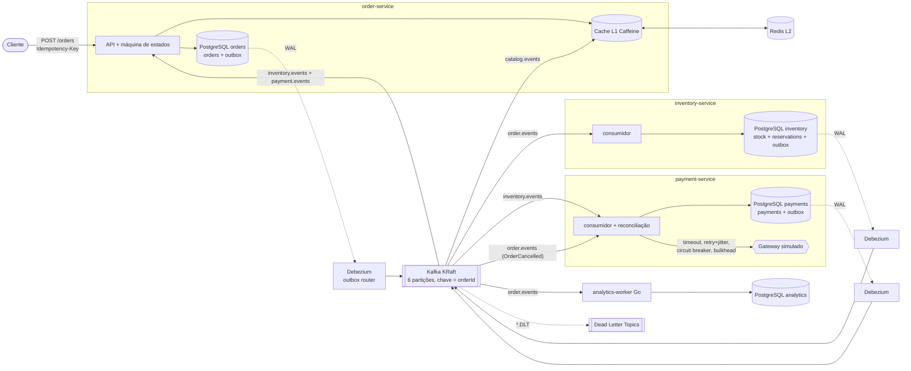
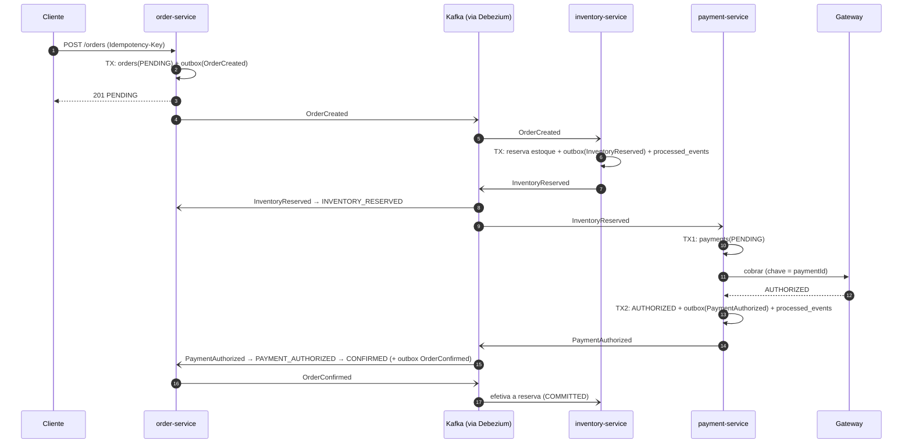
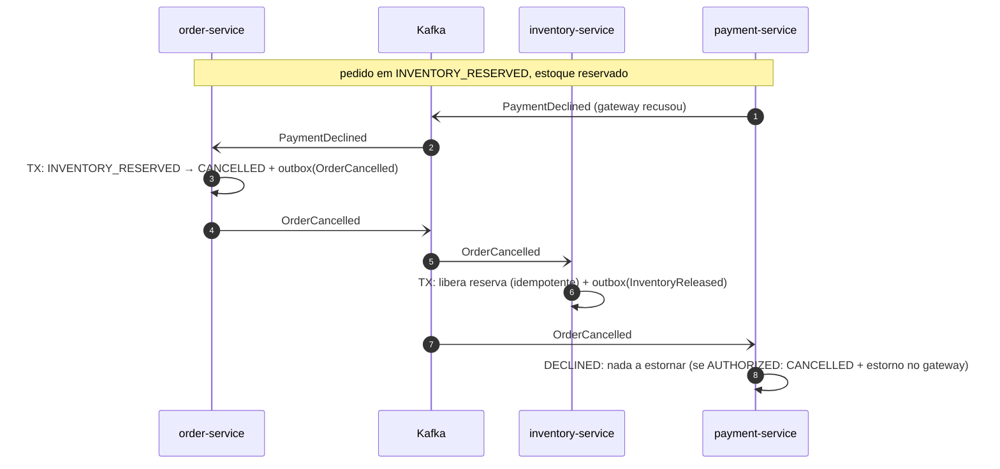

# Marketplace de Pedidos Distribuído

Projeto de portfólio que demonstra, **com código executável e testes que provam o comportamento**, como lidar com falhas parciais,
consistência e escala em um sistema distribuído — não é um CRUD. Três serviços Spring Boot 3 (Java 21), Kafka, Debezium (CDC),
Redis, Resilience4j, observabilidade com Micrometer/OpenTelemetry para o Datadog, um worker em Go e manifests Kubernetes.

> **Leia primeiro a seção [O que foi (e o que não foi) verificado](#o-que-foi-e-o-que-não-foi-verificado).**

## Sumário

1. [Visão geral](#visão-geral) · 2. [Arquitetura](#arquitetura) · 3. [A saga](#a-saga) · 4. [Modelo de consistência](#modelo-de-consistência)
5. [Garantias por componente](#garantias-por-componente) · 6. [Decisões e trade-offs](#decisões-e-trade-offs) · 7. [Como executar](#como-executar)
8. [Testes](#testes) · 9. [Resultados: caos, carga e benchmark](#resultados) · 10. [Observabilidade](#observabilidade-datadog)
11. [Estrutura do repositório](#estrutura-do-repositório) · 12. [Verificado × não verificado](#o-que-foi-e-o-que-não-foi-verificado)

## Visão geral

| Serviço | Responsabilidade | Banco |
|---|---|---|
| **order-service** | cria / consulta / cancela pedidos (REST), dono da máquina de estados do pedido e do catálogo (cache L1+L2) | PostgreSQL `orders` |
| **inventory-service** | reserva e libera estoque por produto | PostgreSQL `inventory` |
| **payment-service** | autoriza/recusa pagamento via **gateway simulado** (latência e falhas configuráveis), reconciliação | PostgreSQL `payments` |
| **analytics-worker** (Go) | agrega eventos de pedido em janelas de 1 minuto | PostgreSQL `analytics` |

Cada serviço tem **seu próprio banco** (database-per-service). Sem transação distribuída (2PC): a consistência entre serviços é eventual,
por uma **saga coreografada** com máquina de estados escrita à mão (sem Axon/Temporal).

## Arquitetura



- **Outbox + CDC**: o evento é gravado na tabela `outbox` na **mesma transação** da mudança de negócio; o **Debezium** lê o WAL e publica
  (não há polling nem relay próprio). Ver [ADR-002](docs/adr/ADR-002-outbox-cdc-vs-polling.md).
- **Chave de partição = `orderId`**: ordem por pedido preservada ([ADR-005](docs/adr/ADR-005-escolha-de-particao.md)).
- **Todos os serviços são stateless**; o único estado em memória são os caches declarados (L1 do catálogo) e o *breaker* do Resilience4j.

## A saga

### Fluxo feliz



### Falha de pagamento → compensações



Falta de estoque é o caso mais curto: `InventoryRejected` → `CANCELLED` (nada a compensar). **Toda compensação parte de um único evento,
`OrderCancelled`**, e é idempotente. Cancelamento pelo cliente (`POST /orders/{id}/cancel`) usa o mesmo caminho; cancelar um pedido
`CONFIRMED` retorna **409**. Detalhes e corridas tratadas: [ADR-001](docs/adr/ADR-001-saga-coreografada-vs-orquestrada.md).

## Modelo de consistência

- **ACID local**: cada serviço usa transações PostgreSQL para as próprias operações; estado + outbox + `processed_events` são atômicos.
- **BASE entre serviços**: *basically available, soft state, eventually consistent*. O pedido passa por estados **explícitos**:

| Estado | Significado | Próximos |
|---|---|---|
| `PENDING` | criado; aguardando estoque | `INVENTORY_RESERVED`, `CANCELLED` |
| `INVENTORY_RESERVED` | estoque reservado; aguardando pagamento | `PAYMENT_AUTHORIZED`, `CANCELLED` |
| `PAYMENT_AUTHORIZED` | cobrança autorizada (confirmação a seguir, na mesma transação) | `CONFIRMED`, `CANCELLED` |
| `CONFIRMED` | terminal | — (cancelar → 409) |
| `CANCELLED` | terminal (compensações executadas) | — |

A máquina de estados (`OrderStateMachine`) é uma **função pura** e tolera eventos duplicados, tardios e fora de ordem entre tópicos
(21 testes unitários). Cada transição fica em `order_status_history`. O estado dos outros serviços é visível em suas tabelas
(`reservations`: `RESERVED → COMMITTED | RELEASED`; `payments`: `PENDING → AUTHORIZED | DECLINED | CANCELLED`).

## Garantias por componente

| Componente | Garantia | Como | Prova |
|---|---|---|---|
| `POST /orders` | idempotente | `Idempotency-Key` + hash canônico, reservado na mesma TX do pedido; payload diferente → 422 | `OrderApiIntegrationTest` (inclui 50 requisições concorrentes → 1 pedido) |
| Escrita de estado + evento | atômica | Transactional Outbox (`Propagation.MANDATORY`) | `OrderApiIntegrationTest` |
| Publicação no Kafka | at-least-once, em ordem por pedido | Debezium (WAL) → chave `orderId`, `acks=all`, idempotent producer | `OutboxCdcTest` |
| Consumidores | efeito único sob reentrega | `processed_events` na mesma TX do efeito | `T02` (2, 10, 100 duplicatas) |
| Cobrança | no máximo uma por pedido | `payments.order_id UNIQUE` + chave idempotente no gateway | `T02`, `T05` |
| Estoque | reserva atômica (todos os itens ou nenhum), sem deadlock | `SELECT … FOR UPDATE` em ordem de produto | `T01`, `T04` |
| Falha parcial | compensação idempotente | `OrderCancelled` → libera/estorna | `T01` |
| Mensagem venenosa | não trava a partição | retry exponencial + jitter → DLT; `PoisonMessage` vai direto à DLT | `T03`, `T07` |
| Gateway de pagamento | falha isolada | timeout, retry (só transitório), circuit breaker, bulkhead | `T06` |
| Pagamento `PENDING` antigo | resolve sozinho | job de reconciliação com o gateway | `T06` |
| Mesmo pedido em paralelo | impossível | partição por `orderId` + lock de linha | `T04` (probe em todo listener) |
| Catálogo em cache | stampede controlado, invalidação por evento | single-flight + lock Redis + TTL com jitter | `CatalogCacheTest` |
| Analytics | idempotente, offset só após gravar | `eventId` + upsert na mesma TX; `CommitMessages` após commit | testes Go |
| Crash do payment-service | converge sem duplicar | reentrega + chave idempotente | `T05` (kill -9) |

## Decisões e trade-offs

| Decisão | Ganho | Custo | ADR |
|---|---|---|---|
| Saga coreografada | sem ponto central, serviços desacoplados | fluxo espalhado; risco de ciclos se crescer | [001](docs/adr/ADR-001-saga-coreografada-vs-orquestrada.md) |
| Outbox + CDC (Debezium) | atomicidade real, baixa latência, ordem do commit | Connect + slot de replicação a operar (WAL retido se parar) | [002](docs/adr/ADR-002-outbox-cdc-vs-polling.md) |
| Idempotência em 3 níveis | efeito único sobre at-least-once | tabelas crescem (retenção é follow-up) | [003](docs/adr/ADR-003-idempotencia.md) |
| Cache L1+L2, invalidação por evento | leitura barata, sem stampede | consistência eventual (ms–1s) no preço | [004](docs/adr/ADR-004-estrategia-de-cache.md) |
| Chave `orderId`, 6 partições | ordem por pedido; paralelismo previsível | teto de 6 consumidores; mudar partições é delicado | [005](docs/adr/ADR-005-escolha-de-particao.md) |
| Gateway fora de TX + reconciliação | não segura conexão em I/O externo; converge | mais estados (`PENDING`), job extra | [006](docs/adr/ADR-006-resiliencia-do-gateway-e-reconciliacao.md) |
| Testcontainers + fallback embarcado | roda em qualquer máquina | dois caminhos de infra | [007](docs/adr/ADR-007-infraestrutura-de-testes.md) |
| Envelope JSON versionado (sem schema registry) | stack enxuta | sem validação automática de compatibilidade | [event-contracts](docs/event-contracts.md) |

Runbook (DLT cresce, lag sobe, circuit breaker abre): [docs/runbook/runbook.md](docs/runbook/runbook.md).

## Como executar

Pré-requisitos: **JDK 21**, Maven 3.9+. Docker é opcional para os testes (há *fallback* embarcado) e necessário para `docker compose`/Kubernetes.
Go 1.27+ (ver `analytics-worker/go.mod`) para o worker; k6 para a carga.

### 1. Testes (funciona com ou sem Docker)

```bash
export JAVA_HOME=/caminho/para/jdk-21
mvn verify                          # unitários + integração (Testcontainers se houver Docker; senão infra embarcada)
mvn verify -Dsaga.test.infra=embedded   # força o modo embarcado (sem Docker)
cd analytics-worker && go test ./...    # + TEST_DATABASE_URL=postgres://... para os testes com PostgreSQL
```

### 2. Tudo em um comando (docker compose)

```bash
make up                  # sobe toda a stack, espera, roda o smoke test e os testes de integração
REPLICAS=3 make up       # 3 réplicas de cada serviço
# Windows sem make:  .\scripts\up.ps1 [-Replicas 3]
```

Entrada única: `http://localhost:8080` (nginx → order-service). Kafka Connect: `:8084`. Métricas do worker Go: `:9100/metrics`.

```bash
curl -X POST localhost:8080/orders -H 'Content-Type: application/json' -H 'Idempotency-Key: abc-1' \
  -d '{"customerId":"c-1","items":[{"productId":"P-001","quantity":2}]}'
curl localhost:8080/orders/<id>
curl -X POST localhost:8080/orders/<id>/cancel
curl -X PUT localhost:8080/catalog/products/P-001 -H 'Content-Type: application/json' -d '{"name":"Teclado","price":299.9}'  # invalida o cache
```

Produtos seed: `P-001…P-010` (`P-009` tem só 5 unidades → falta de estoque). Cliente cujo id começa com `decline` é recusado no pagamento;
pedidos acima de R$ 10.000 também.

### 3. Sem Docker: stack completa em um processo

```bash
./scripts/local-stack.sh start 3      # PostgreSQL + Kafka + Redis + Debezium embarcados + 3 réplicas de cada serviço
BASE_URL=http://localhost:8081 ./scripts/smoke-test.sh
./scripts/load-test.sh 3-replicas 3 60 60s    # carga k6 (K6=/caminho/k6)
./scripts/local-stack.sh stop
```

### 4. Kubernetes (kind ou minikube)

```bash
make k8s-kind      # = kind create cluster + build/load das 4 imagens + kubectl apply do overlay kind (1 réplica, cabe em 8 GB)
                   # (precisa de metrics-server para o HPA: kubectl apply -f https://github.com/kubernetes-sigs/metrics-server/releases/latest/download/components.yaml)
# ou, em um cluster existente (imagens saga/*:local disponíveis):
kubectl kustomize --load-restrictor=LoadRestrictionsNone k8s/base | kubectl apply -f -
# escala por LAG do Kafka (requer KEDA):
kubectl kustomize --load-restrictor=LoadRestrictionsNone k8s/overlays/keda | kubectl apply -f -
curl localhost:8080/orders ...   # NodePort 30080 mapeado em k8s/kind-config.yaml
```

Os manifests têm `requests`/`limits`, probes `startup`/`liveness`/`readiness` separadas, PodDisruptionBudget, HPA por CPU
(consumidores com teto = partições / concorrência, [ADR-005](docs/adr/ADR-005-escolha-de-particao.md)) e ScaledObjects KEDA por lag.

### 5. Datadog (opcional)

```bash
COMPOSE_PROFILES=datadog DD_ENABLED=true DD_API_KEY=... docker compose up -d    # Agent com OTLP (4318) + integração Kafka
DD_API_KEY=... DD_APP_KEY=... ./scripts/datadog-apply.sh                         # dashboard, SLO e monitores
```

## Testes

| Suíte | Onde | Nº | O que prova |
|---|---|---|---|
| Máquina de estados da saga | `order-service` `OrderStateMachineTest` | 21 | todas as transições, duplicatas, eventos tardios, reordenação, cancelar `CONFIRMED` |
| Backoff com jitter | `common` | 2 | crescimento exponencial, teto, jitter variável, parada |
| API + outbox + Idempotency-Key | `OrderApiIntegrationTest` | 9 | atomicidade pedido+outbox, replay, 422, 50 requisições concorrentes → 1 pedido |
| CDC | `OutboxCdcTest` | 2 | linha do outbox chega ao Kafka via Debezium, chave = `orderId`, mesma partição e ordem |
| Cache | `CatalogCacheTest` | 7 | camadas, cache negativo, **stampede (300 threads → 1 carga; 2 instâncias → 1 carga)**, TTL jitter, invalidação por evento, Redis fora |
| Saga completa | `T01_SagaFlowTest` | 6 | fluxo feliz, falha de estoque, **falha de pagamento com compensação**, regras de cancelamento |
| **Reentrega de evento duplicado** | `T02_DuplicateEventsTest` | 3 | **2, 10 e 100** entregas ⇒ efeito único em todos os consumidores |
| DLT / mensagem venenosa | `T03_PoisonMessageDltTest` | 2 | vai para a DLT; a partição não trava |
| **3 réplicas por serviço** | `T04_ReplicasTest` | 1 | **0** processamentos paralelos do mesmo pedido, nada perdido/duplicado |
| **Caos** | `T05_ChaosPaymentCrashTest` | 1 | `kill -9` do payment-service com pagamento `PENDING`; converge sem duplicar cobrança nem reserva |
| Resiliência | `T06_ResilienceTest` | 4 | retry, circuit breaker abre, reconciliação (2 casos) |
| Retry exponencial + jitter + DLT | `T07_RetryBackoffDltTest` | 2 | intervalos medidos, DLT após esgotar |
| Trace único | `T08_TracePropagationTest` | 1 | um `traceId` atravessa HTTP → 3 serviços → Kafka/Debezium |
| Logs JSON | `T09_JsonLoggingTest` | 1 | `traceId`, `orderId`, `eventId` nos logs |
| Go (analytics) | `analytics-worker` | 7 | janelas, parse, idempotência (1/2/10/100 reaplicações, 8 workers concorrentes) |
| Carga | `load-test/orders.js` (k6) | — | ver [resultados](load-test/results/RESULTS.md) |

## Resultados

### Caos e resiliência — [docs/chaos-results.md](docs/chaos-results.md)

`kill -9` do payment-service com o pagamento `PENDING` e a cobrança já efetivada no gateway:

```
[T05] payment-service morto (kill -9) com pagamento afad5732-... PENDING
[T05] convergiu: 1 pagamento, 1 cobranca no gateway, 1 reserva; pedido CONFIRMED
```

### Carga (k6) — antes e depois de escalar — [load-test/results/RESULTS.md](load-test/results/RESULTS.md)

60 pedidos/s por 60s, mesma máquina (relativo, não absoluto):

| | 1 réplica/serviço | 3 réplicas/serviço |
|---|---|---|
| `POST /orders`: throughput · p95 · p99 | 60/s · 12,6 ms · 40,1 ms | 60/s · 13,0 ms · 26,0 ms |
| saga ponta a ponta p50 · p95 · p99 | 17,6 s · 33,2 s · 35,6 s | **0,76 s · 1,37 s · 2,01 s** |
| tempo para drenar 3.600 pedidos | 198 s | **68 s** |

A criação (síncrona) nunca foi o gargalo; escalar os consumidores é o que faz a saga acompanhar a chegada.

### Go × Java (analytics) — [docs/benchmarks/analytics-throughput.md](docs/benchmarks/analytics-throughput.md)

Mesmo algoritmo (lote de 500 → 1 transação → commit do offset depois), 170 mil eventos pré-carregados:

| Instâncias | Java | Go |
|---|---|---|
| 1 | 44.494 ev/s | 51.250 ev/s (1,15×) |
| 3 | 91.451 ev/s | 76.979 ev/s (0,84×) |

Conclusão honesta: **empate técnico**. O gargalo é o PostgreSQL local compartilhado, não a linguagem; Go leva vantagem pequena com 1 instância
e o Java com 3 (a diferença está dentro do que variaria entre execuções; foi uma execução por configuração). O que diferencia na prática é o
empacotamento: o worker Go é **um binário estático de 21 MB** (imagem *distroless*, ver `analytics-worker/Dockerfile`) contra uma JVM + Spring
nos serviços Java. Consumo de memória e tempo de partida **não foram medidos** e por isso não entram na comparação.

## Observabilidade (Datadog)

- **Traces e métricas**: Micrometer + OpenTelemetry → OTLP/HTTP para o Datadog Agent (`management.otlp.*`, métricas em *delta*).
- **Uma saga = um trace**: o `traceparent` é gravado na coluna do outbox, o `EventRouter` do Debezium o copia para um header Kafka e o
  Spring Kafka (observation) continua o trace no consumidor — provado em `T08` (um `traceId`, 8 spans, 3 serviços).
- **Logs estruturados em JSON** (`SPRING_PROFILES_ACTIVE=json`) com `traceId`, `spanId`, `orderId`, `eventId`, `eventType`.
- **Dashboard versionado** — [infra/datadog/dashboard.json](infra/datadog/dashboard.json): pedidos por estado, latência de cada etapa
  (`saga.event.latency`), lag do consumer group, tamanho da DLT, hit ratio do cache, taxa de erro do circuit breaker, disponibilidade da criação.
- **Monitores** — [monitors.json](infra/datadog/monitors.json): *lag alto*, *DLT crescendo*, *circuit breaker aberto*, *SLO queimando*.
- **SLO** — [slo.json](infra/datadog/slo.json): disponibilidade de `POST /orders` (sem 5xx) ≥ 99,9% em 30 dias.
- Métricas de negócio: `orders.state.transitions{from,to}`, `orders.saga.duration{outcome}`, `saga.event.latency{consumer,type}`,
  `saga.events.processed{outcome}`, `saga.dlt.published{topic}`, `catalog.cache.hit.ratio{layer}`, `payment.gateway.charge`,
  `payments.reconciled`, `resilience4j.*`. O worker Go expõe `analytics_*` em `/metrics` (Prometheus).

## Estrutura do repositório

```
common/                 contrato de eventos, outbox, consumidor idempotente, retry+jitter+DLT
services/
  order-service/        API, máquina de estados, catálogo + cache L1/L2, Idempotency-Key
  inventory-service/    reserva/liberação/efetivação de estoque
  payment-service/      cobrança (gateway simulado), Resilience4j, reconciliação
analytics-worker/       worker em Go (janelas de 1 min, idempotente, métricas Prometheus)
integration-tests/      saga completa: fluxo, duplicatas, réplicas, caos, resiliência, trace, logs
test-support/           Testcontainers ou infra embarcada + Debezium Embedded Engine
local-stack/            stack sem Docker (+ benchmark Go × Java)
infra/                  conectores Debezium, nginx, Datadog (dashboard, monitores, SLO, agente)
k8s/                    manifests (kustomize) + overlay KEDA + kind
load-test/              k6 + resultados versionados
docs/                   ADRs, contratos de eventos, runbook, caos, benchmarks
scripts/                up.sh/up.ps1, smoke-test, local-stack, load-test, datadog-apply
```

## O que foi (e o que não foi) verificado

**Executado e passando** (Windows 10, JDK 21.0.12, Go 1.27, Docker Desktop 29):

- `mvn verify`: **common** (2), **order-service** (39), **integration-tests** (21: T01–T09) = **62 testes Java, verdes nos DOIS modos**:
  Testcontainers (`-Dsaga.test.infra=docker`: PostgreSQL, Kafka e Redis em containers) e infra embarcada (`-Dsaga.test.infra=embedded`).
  Go: 7 testes (3 com PostgreSQL real).
- **`docker compose` de verdade** (`scripts/up.sh`): 12 containers saudáveis, os **3 conectores Debezium em `RUNNING` no Kafka Connect real**, nginx,
  analytics-worker consumindo, e o `scripts/smoke-test.sh` passando — com 1 e com **3 réplicas** de cada serviço, e em subida a frio (tudo ao mesmo tempo).
- Teste de caos com `kill -9` de um processo real; carga k6 contra o `local-stack` (1 e 3 réplicas) **e contra o compose com 3 réplicas**
  ([resultados](load-test/results/RESULTS.md)); benchmark Go × Java.
- **Kubernetes de verdade, em kind** (overlay `k8s/overlays/kind`, 1 réplica; o Docker local tem só 8 GB): todos os pods saudáveis, `connector-init`
  registrou os 3 conectores (`RUNNING`), smoke test passando pelo NodePort, worker Go agregando; com `metrics-server`, o **HPA escalou** sob carga
  (`inventory`/`payment` 1→3, o teto = partições ÷ concorrência; `order-service` 1→6). Depois de ~14,7 mil pedidos (inclusive com pods de
  inventory mortos à força no meio da carga) o estado final convergiu: **todos os pedidos terminais, 0 pagamentos duplicados, 0 reservas órfãs**.
  Ressalva: nessa execução o `kubectl delete` dos pods de payment falhou por timeout da API (cluster saturado) — só os de inventory foram mortos.
- Validação **estática**: `docker compose config` (com e sem o profile `datadog`), `kubectl kustomize` (base, kind e KEDA) e os
  JSON do Datadog/Debezium são válidos.

**Bugs que SÓ apareceram ao rodar com Docker (e foram corrigidos)** — o motivo de rodar tudo de verdade:

1. `analytics-worker` não consumia nada quando subia antes do tópico `order.events` existir (o `kafka-go` entra no grupo sem partições). Agora ele
   espera o tópico existir (`waitForTopic`).
2. Consumidores subindo antes do produtor deixavam a saga parada até o refresh de metadata do Kafka (5 min): cada serviço produzia só os próprios tópicos.
   Agora **todos declaram todos os tópicos** (`SagaTopicsConfig`, idempotente) e `metadata.max.age.ms=30s`.
3. Testcontainers 1.21 não fala com o Docker Engine 29 (*"client version 1.32 is too old"*): `test-support/src/main/resources/docker-java.properties` fixa `api.version=1.44`.
4. Corridas nos testes (reserva `COMMITTED` e assignment do listener de cache são assíncronos): os testes agora esperam em vez de assumir.
5. **Kubernetes**: o manifest dos serviços apontava para `payments-db` (o Service é `payment-db`) e o Service `redis` injeta `REDIS_PORT=tcp://ip:6379`, que
   quebrava o bind de `spring.data.redis.port` — agora a propriedade é `SAGA_REDIS_PORT` e os pods têm `enableServiceLinks: false`.
   Em kind, `kind load docker-image` falha para imagens de terceiros com o *image store* containerd do Docker Desktop (só as imagens `saga/*` são carregadas;
   as demais o nó baixa), e o HPA precisa do `metrics-server` (com `--kubelet-insecure-tls` no kind).

**Escrito mas NÃO executado**:

- **KEDA** (overlay por lag do Kafka): renderiza, mas o KEDA não foi instalado no cluster. O HPA por CPU foi exercitado.
- **Kafka com 3 brokers / base completo com 3 réplicas fixas em kind**: o overlay base (requests maiores) não cabe em 8 GB; só o overlay `kind` rodou.
- **Datadog**: o dashboard, monitores e SLO foram escritos conforme o formato da API e validados como JSON, **não** importados em uma conta;
  o nome exato de algumas métricas depende da conversão OTLP→Datadog (`histograms.mode=distributions` está no compose). Ajuste ao importar.
  O container do Datadog Agent (profile `datadog`) também não foi iniciado (exige `DD_API_KEY`).
- O **desempenho absoluto** (carga e benchmark) vem de uma única máquina: vale a relação entre execuções, não os números.

**Fora do escopo / follow-ups conscientes**: retenção de `outbox` e `processed_events`; schema registry; Kafka com 3 brokers (RF=3) e PostgreSQL
com HA; autenticação; o catálogo mora no order-service (um serviço de catálogo próprio seria o passo seguinte).
